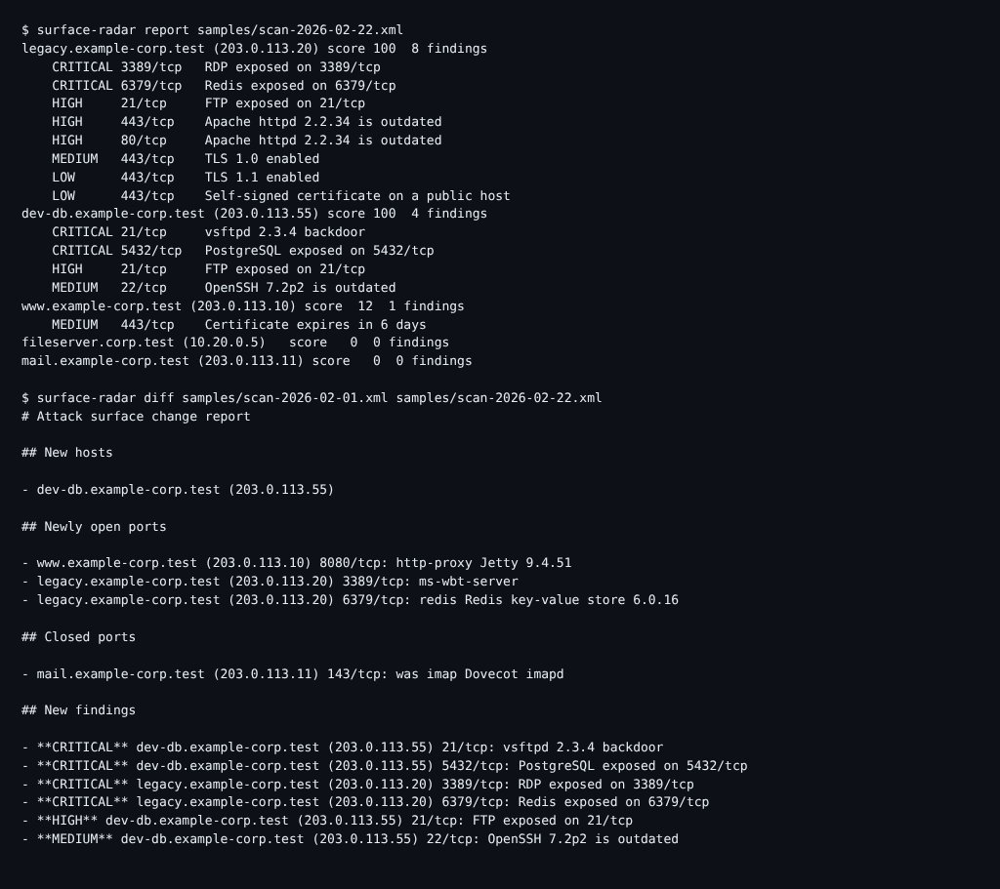

# surface-radar

[](https://github.com/jvch0512/surface-radar/actions/workflows/ci.yml)

Turns `nmap -oX` scans into an attack surface report and a change report between two scans. It scores each host, flags exposed services, outdated software, weak TLS and expiring certificates, and tells you what changed since last time. Java 17, `javac` only, no dependencies.

**It never touches the network.** It reads XML you already have, so it is safe to run in CI and on a laptop, and it never scans anything you did not scan yourself.



## Use

```bash
./build.sh test                                    # 26 tests
java -cp out/main dev.jvch.radar.Main report samples/scan-2026-02-22.xml
java -cp out/main dev.jvch.radar.Main diff samples/scan-2026-02-01.xml samples/scan-2026-02-22.xml
```

Scan with, for example: `nmap -sV --script ssl-cert,ssl-enum-ciphers -oX scan.xml TARGETS`.

| Option | Meaning |
|---|---|
| `--format text\|md\|json` | report defaults to text, diff to Markdown. |
| `--scope external\|all` | Flag risky services only on public addresses (default) or on every host. |
| `--fail-on critical\|high\|medium\|low\|none` | Exit 1 at or above this level. For `diff` only new findings count, so a known backlog does not break the build. Default `critical`. |

Exit codes: 0 clean, 1 findings at the threshold, 2 usage or input error.

## What it flags

| Rule | Examples | Severity |
|---|---|---|
| Exposed service | Telnet, SMB, RDP, VNC, Docker API, etcd, Kubelet, Redis, Memcached, MongoDB, MySQL, PostgreSQL, MSSQL, Oracle, Elasticsearch | critical |
| | FTP, TFTP, MS-RPC, NetBIOS, SNMP, LDAP, NFS, CouchDB, WinRM | high |
| | rpcbind | medium |
| Outdated software | Apache 2.2, PHP before 7.4, OpenSSL before 1.1.1, IIS before 10 | high |
| | OpenSSH before 7.4, nginx before 1.18, MySQL 5.x, Tomcat 8.5 and older | medium |
| Backdoored release | vsftpd 2.3.4 | critical |
| Weak TLS | SSLv3 high, TLS 1.0 medium, TLS 1.1 low | |
| Certificate | expired high, expires within 30 days medium, self-signed on a public host low | |

Risky services are also caught on non-standard ports through nmap's detected service name (RDP on 33890 is still RDP). A host score is the sum of its finding weights (40, 25, 12, 4), capped at 100.

## Diff

Hosts are matched by address. The change report lists new and vanished hosts, newly opened and closed ports, banner or version changes, and findings that appeared or were resolved. A finding that only changed its wording ("expires in 28 days" to "6 days") is the same finding, so it does not show up as new every week.

## Sample

`samples/` holds two fictional scans three weeks apart (made by `tools/gen_samples.py`, invented hostnames, documentation address ranges). Between them a dev database appeared with a backdoored FTP server, RDP and Redis opened on the legacy box, and a mail port closed. [sample-report.md](docs/sample-report.md), [sample-diff.md](docs/sample-diff.md) and [sample-report.json](docs/sample-report.json) are the real output, and CI fails if they drift. Documentation ranges (192.0.2/24, 198.51.100/24, 203.0.113/24) count as public so the samples behave like real internet-facing hosts.

## Security notes

- Scan files are untrusted input. The XML parser refuses any DOCTYPE, which closes XXE and entity expansion, and rejects files over 64 MiB.
- Banners come from the scanned host. Markdown output escapes pipes, brackets and angle brackets and flattens newlines, and the JSON writer escapes control characters, so a hostile banner cannot forge a table row, a link or HTML.
- Compiled with `-Xlint:all -Werror`.

## Limits

Heuristics, not a vulnerability scanner. It does not match CVEs. Version checks read what the banner says, and distributions backport fixes without changing the version, so an "outdated" finding on a patched Debian or RHEL package is a prompt to verify, not proof. Public versus internal is decided from the address alone.

MIT licensed.
